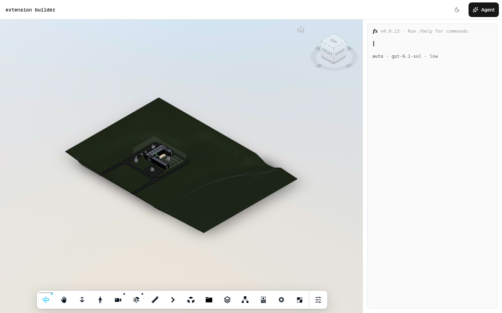
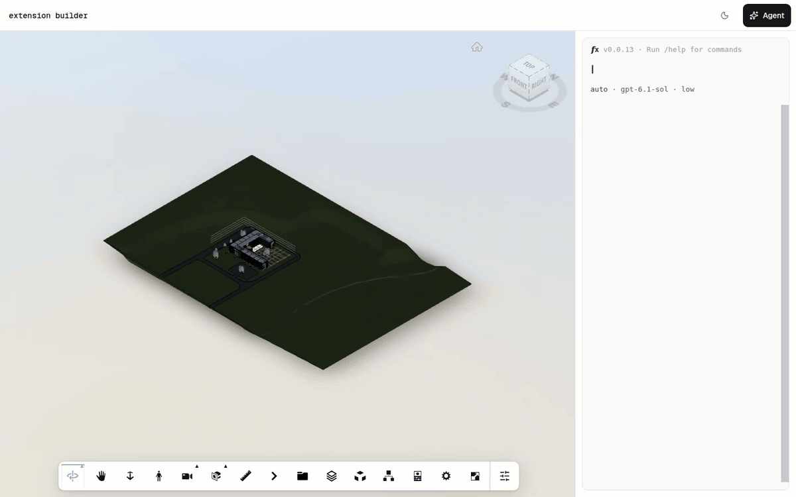

# Viewer Extension Builder

Describe an Autodesk Viewer extension in plain words. The fx agent writes it, checks it, loads it into the live viewer, presses its button, fixes what breaks, and hands you a folder that drops into any Viewer v7 app. The app is built on [cantera](https://github.com/mrestrepoj10/cantera) ([canteraui.vercel.app](https://canteraui.vercel.app)), the shadcn registry for construction UI. It installs the `@cantera/viewer-agent` template, which puts a translated model in a full-bleed Autodesk Viewer with the fx coding agent docked beside it as a terminal, and turns that template into an extension builder.

[](https://vercel.com/new/clone?repository-url=https://github.com/mrestrepoj10/viewer-extension-builder&env=APS_CLIENT_ID,APS_CLIENT_SECRET,APS_MODEL_URN,AI_GATEWAY_API_KEY,DATABASE_URL,BLOB_READ_WRITE_TOKEN)



## How it works

fx runs in the browser on [libfx](https://www.npmjs.com/package/libfx). Its workspace is a sandboxed bash over an in-memory filesystem at `/model`, with no network. Next to the `viewer` command (the cantera viewer tools), the agent gets two more commands:

| Command | What it does |
| --- | --- |
| `ext new <Id> [--from <Example>]` | Copies `BasicSkeleton`, or one of the examples, to `/model/extensions/<Id>/` and renames it |
| `ext list` | Lists the extension folders: references, drafts, and which are loaded |
| `ext check <Id>` | Validates `config.json`, parses `main.js` with acorn, then lints it with ESLint plus viewer rules |
| `ext load <Id>` | Checks, replaces the previous version, injects the script and stylesheet, calls `viewer.loadExtension`, and reports `load()`, errors at line:col, and the toolbar controls and DOM nodes that appeared |
| `ext click <Id> <control-id>` | Clicks a toolbar control the extension added and reports the button state, the panels that opened or closed with the start of their text, and any errors |
| `ext unload <Id>` | Unloads and unregisters it, then lists anything `unload()` left behind |
| `ext errors [<Id>]` | Prints the runtime errors captured since the last load |
| `ext export <Id>` | Downloads the folder as a zip with a `LOAD.md` drop-in snippet |
| `docs grep <pattern>` / `docs show <path>` | Search and read the offline Viewer v7 and Data Visualization docs under `/docs` |

Each extension follows the [aps-extensions](https://github.com/autodesk-platform-services/aps-extensions) folder format:

```
/model/extensions/<Id>/
  config.json        {"name": "<Id>", "displayname", "description", "options": {},
                      "viewerversion": "7.*", "loadonstartup": "false",
                      "filestoload": {"cssfiles": ["main.css"], "jsfiles": ["main.js"]},
                      "bundleAlias": "<Id>"}
  contents/main.js   plain script, no import/require/export
  contents/main.css  optional
```

`main.js` defines one class that extends `Autodesk.Viewing.Extension`. Its `load()` and `unload()` both return `true`, `unload()` removes everything the extension added, and the file ends with `Autodesk.Viewing.theExtensionManager.registerExtension('<Id>', Class)`.

The check pipeline runs in order and stops at the first failing stage: config contract, syntax (acorn, plain script), then ESLint core rules with browser, `Autodesk`, and `THREE` globals plus four viewer rules (one extension class with `load()`/`unload()` returning true, one top-level `registerExtension`, no `require`/`import()`/`eval`, and an `unload()` cleanup warning). Loading never runs generated code inside a bash command: the command calls a page-side runtime that injects a blob `<script>` with `//# sourceURL=ext/<Id>/main.js`, so errors map back to the file. The agent's system prompt carries a short skill of extension patterns (`lib/extension-library/SKILL.md`). The **Extensions** overlay in the bottom-left corner of the viewer has one chip per loaded extension, with Unload, Export, and Publish.

## Gallery

The home page is a public gallery of published extensions; the builder lives at `/agent`. Every chip in the **Extensions** overlay has a **Publish** button. It opens a dialog with the title and description from `config.json`, your display name (remembered in this browser, `anonymous` when blank), the first prompt of the session if there was one, and a 1200×750 thumbnail: the viewer canvas with the extension's open panels and labels drawn where they sit.

Each published extension gets a page at `/e/<id>` that runs it in the viewer through the same loader as `ext load`, with **Remix in builder** (opens `/agent?remix=<id>`, which writes the folder to `/model/extensions/<Id>/` before the agent starts and tells the agent in its first workspace message), **Download .zip**, and **Copy loader snippet** (a `<script>` tag for the public `main.js` plus `viewer.loadExtension('<Id>')`).

What is stored:

- **Vercel Blob** (public), under `gallery/<id>/`: the zip from `ext export`, `<Id>/contents/main.js`, `<Id>/contents/main.css` when there is one, and `thumbnail.jpg`.
- **Postgres**, one `extensions` row per publish: id, title, description, author, extension id, prompt, agent model, the Blob URLs, `config.json` as jsonb, the SHA-256 of the edit token, and the time.

The server rebuilds the zip from the submitted files, checks `config.json` with the same contract as `ext check` and `main.js` with acorn, and refuses a zip over 2 MB or a thumbnail over 1 MB. Publishing is limited to 10 per IP per 10 minutes on each server instance.

There are no accounts yet. Publishing returns an edit token once; the browser keeps it in `localStorage`, and the extension's page shows **Delete** only where that token is. Delete removes the row and the Blob files. Clearing site data loses the token, and with it the way to delete from the page; the owner of the deployment can still delete the row and the `gallery/<id>/` files directly.

Set up storage once per deployment: add a Neon Postgres database and a public Blob store to the Vercel project (they set `DATABASE_URL` and `BLOB_READ_WRITE_TOKEN`), pull them with `vercel env pull .env.local`, then run `pnpm db:migrate`. The builder works without them; the gallery page then says that storage is missing.

## A recorded session

One prompt, no edits: *"Build an extension called CurtainWallAudit: a toolbar button that colours curtain wall panels by level and opens a panel listing panel counts per level; load it, click the button with ext click, and fix anything the check reports."* The agent read the examples, queried the model (811 curtain panels), wrote the extension, loaded it, clicked its button, resolved the numeric level references it found, removed a broken CSS block it had copied, and finished with check, load, click, errors, and unload all clean.



[Full-quality video (webm)](docs/session.webm) · [final frame](docs/session.png)

## Worked examples

Read-only references under `/model/extensions/`, written against the Commercial Office sample model (Revit, feet, Levels 1 to 4, no rooms). The agent copies from them with `ext new <Id> --from <Example>`.

- **LevelColors**: a toolbar button and a `DockingPanel` listing levels from the AEC model data. Picking a level colours its floors with `setThemingColor`, isolates its elements, and fits the view.
- **DoorSchedule**: a panel that counts doors by family and type (`model.search` plus `getBulkProperties2`), with a per-level breakdown. Clicking a type selects its doors and zooms to them.
- **WallMeasure**: a `ToolInterface` tool. Click two points on walls: it draws an overlay line and shows the distance on a label that follows the camera. Esc clears.

`BasicSkeleton` is the minimal starting point: a toolbar button and a selection listener, both cleaned up on unload.

## Environment

Copy `.env.example` to `.env.local` and fill in every key.

| Key | Required | Meaning |
| --- | --- | --- |
| `APS_CLIENT_ID` | yes | Client ID of your APS app (aps.autodesk.com). |
| `APS_CLIENT_SECRET` | yes | Client secret of the same APS app. |
| `APS_MODEL_URN` | yes | Base64 Model Derivative URN of a model Autodesk has already translated, with or without the `urn:` prefix. The examples assume the Commercial Office sample. |
| `AI_GATEWAY_API_KEY` | yes | Vercel AI Gateway key, held by the `/api/agent/gateway` proxy route and never sent to the browser. Only the model in `lib/agent-model.ts` is allowed through. |
| `DATABASE_URL` | for the gallery | Postgres connection string (the Neon integration sets it). Run `pnpm db:migrate` once against it. |
| `BLOB_READ_WRITE_TOKEN` | for the gallery | Read-write token of a public Vercel Blob store, where published files and thumbnails go. |

## Run locally

```sh
pnpm install
cp .env.example .env.local
pnpm dev
```

Open http://localhost:3000 for the gallery and http://localhost:3000/agent for the builder. libfx needs WebAssembly JSPI: use Chrome or Edge 137+, or Safari 27+.

| Script | What it does |
| --- | --- |
| `pnpm dev` / `pnpm build` | Next.js dev server / production build |
| `pnpm lint` | Next's ESLint config |
| `pnpm check` / `pnpm format` | Biome check / format in place |
| `pnpm db:migrate` | Creates the gallery's `extensions` table in `DATABASE_URL` (reads `.env.local`); safe to rerun |
| `pnpm docs:build` | Rebuilds the offline docs from the APS docs portal (TOC JSON from developer.doc.config.autodesk.com, pages from developer.doc.autodesk.com), then runs `docs:regen` |
| `pnpm docs:regen` | Regenerates `lib/extension-library/generated/*.ts` after editing an example, the docs text, or `SKILL.md` |

Both docs scripts are deterministic. `DOCS_CACHE_DIR=<dir>` keeps the raw HTML between `docs:build` runs.

To pull a newer cantera template, run `pnpm dlx shadcn@latest add @cantera/viewer-agent -o`. That overwrites local edits in `components/viewer-agent.tsx` and `components/ui/fx-terminal/`, where this repo wires in the `ext` and `docs` commands, so review the diff.

## Limits

- Two models: `openai/gpt-6.1-sol` (default, low effort) and `anthropic/claude-haiku-5.5`, both in `lib/agent-model.ts`; switch for the session with `/model anthropic/claude-haiku-5.5 low` in the terminal. The gateway route rejects any other.
- The workspace lives in memory. A reload loses every draft that you have not exported.
- There is no auth. Anyone who can open the page spends your AI Gateway credit, so do not expose a deployment with an unbudgeted key. Set a budget on the key, or put the app behind Vercel deployment protection.
- Extensions run in the page with full access to it. Read what the agent wrote before you ship it. The same holds for every gallery page: opening one runs someone else's code.
- Anyone can publish to the gallery of a deployment, within the per-IP limit. There is no moderation.
- `viewer take_screenshot` captures the 3D canvas only. Toolbar buttons and panels are reported as text by `ext load` and `ext click`.

## Credits

- [cantera](https://github.com/mrestrepoj10/cantera): the viewer-agent template, APS viewer, and fx terminal components.
- [fx](https://www.npmjs.com/package/libfx) and libfx: the coding agent and its in-browser runtime, with [just-bash](https://www.npmjs.com/package/just-bash) for the workspace.
- [aps-extensions](https://github.com/autodesk-platform-services/aps-extensions): the extension folder format.
- [APS Viewer documentation](https://aps.autodesk.com/en/docs/viewer/v7/developers_guide/overview/): the source of the offline docs index.

## License

MIT
